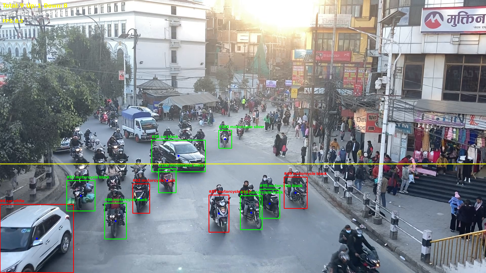

@'
# Vehicle Analytics

Real-time vehicle counting and analytics from a traffic video stream.
The system detects vehicles, tracks them, finds their colour, counts each one
once when it crosses a virtual line, stores every crossing in PostgreSQL and
shows live analytics on a React dashboard next to the live video.


## Features

- Vehicle detection with **YOLOv8n** (car, motorcycle, bus, truck)
- Multi-object tracking with **ByteTrack** (each vehicle gets a stable ID)
- Line-crossing counter with direction (**up / down**), no double counting
- Vehicle colour from a secondary classifier (**CLIP** zero-shot on the cropped
  bounding box), with a majority vote over several frames per vehicle
- Every crossing saved to **PostgreSQL**
- **FastAPI** backend with analytics endpoints
- **React** dashboard (Vite + Recharts) with live HLS video, stats, charts and
  recent events, auto-refreshing every 5 seconds
- Video served as an RTSP stream with **MediaMTX** (also exposed as HLS for the browser)

## Architecture

```
traffic.mp4 --ffmpeg--> MediaMTX (RTSP :8554 / HLS :8888)
                              |                    |
                              v                    v
              pipeline (YOLOv8n + ByteTrack     React dashboard
                        + CLIP colour)          (live video)
                              |                    ^
                              v                    |
                         PostgreSQL  -------->  FastAPI (:8000)
                       (vehicle_events)
```

## Tech stack

| Part        | Tools                                    |
|-------------|------------------------------------------|
| Detection   | Ultralytics YOLOv8n                      |
| Tracking    | ByteTrack (built into Ultralytics)       |
| Colour      | OpenAI CLIP (`openai/clip-vit-base-patch32`) via Hugging Face Transformers |
| Streaming   | MediaMTX, FFmpeg                         |
| Database    | PostgreSQL, psycopg2                     |
| Backend     | FastAPI, Uvicorn                         |
| Frontend    | React (Vite), Recharts, hls.js           |

## Project structure

```
vehicle-analytics/
├── backend/        FastAPI app (main.py)
├── database/       SQL for the vehicle_events table
├── docs/           Screenshots
├── frontend/       React dashboard (Vite)
├── mediamtx/       MediaMTX config (binary not committed)
├── pipeline/       Detection, tracking, colour, counting
├── scripts/        Helper scripts
├── videos/         Input video (not committed)
├── requirements.txt
└── .env            Database settings (not committed)
```

## Setup

### 1. Requirements

- Python 3.10+
- Node.js 18+
- PostgreSQL
- FFmpeg (on PATH)
- MediaMTX (download the Windows binary and put `mediamtx.exe` in `mediamtx/`)

### 2. Python environment

```powershell
python -m venv venv
venv\Scripts\Activate.ps1
pip install -r requirements.txt
```

The YOLOv8n weights and the CLIP model (~600 MB) download automatically on first run.

### 3. Database

Create a database called `vehicle_analytics` and run the SQL file in `database/`
to create the `vehicle_events` table.

Then create a `.env` file in the project root:

```
DB_HOST=localhost
DB_PORT=5432
DB_NAME=vehicle_analytics
DB_USER=postgres
DB_PASSWORD=your_password
```

### 4. Frontend

```powershell
cd frontend
npm install
```

### 5. Video

Put a traffic video at `videos/traffic.mp4`.

## Running

Use a separate terminal for each step, in this order.

**1. MediaMTX**

```powershell
mediamtx\mediamtx.exe
```

**2. Stream the video (loops forever)**

```powershell
ffmpeg -re -stream_loop -1 -i videos/traffic.mp4 -an -c:v libx264 -preset veryfast -tune zerolatency -g 60 -pix_fmt yuv420p -rtsp_transport tcp -f rtsp rtsp://localhost:8554/traffic
```

The video is re-encoded without audio, because MediaMTX rejected the original
audio track (`400 Bad Request`).

**3. Pipeline** (with venv active)

```powershell
python pipeline/track_count.py
```

Press `q` in the video window to stop.

**4. Backend** (with venv active, from the project root)

```powershell
uvicorn backend.main:app --reload --port 8000
```

API docs: http://localhost:8000/docs

**5. Dashboard**

```powershell
cd frontend
npm run dev
```

Open http://localhost:5173

## API

| Method | Endpoint                          | Description                            |
|--------|-----------------------------------|----------------------------------------|
| GET    | `/api/total`                      | Total vehicles counted                 |
| GET    | `/api/stats/types`                | Count per vehicle type                 |
| GET    | `/api/stats/colors`               | Count per vehicle colour               |
| GET    | `/api/events/recent?limit=20`     | Latest crossing events                 |
| GET    | `/api/analytics/history?hours=24` | Vehicles per hour for the last N hours |

## Database table: `vehicle_events`

| Column          | Meaning                                    |
|-----------------|--------------------------------------------|
| `id`            | Row id                                     |
| `vehicle_id`    | ByteTrack ID of the vehicle                |
| `vehicle_type`  | car / motorcycle / bus / truck             |
| `vehicle_color` | black / white / silver / grey / red / blue |
| `direction`     | up / down                                  |
| `timestamp`     | Time the vehicle crossed the line          |

## How it works

1. **Detect**: YOLOv8n finds vehicles in each frame (confidence >= 0.35).
2. **Track**: ByteTrack links detections across frames so each vehicle keeps one ID.
3. **Colour**: every 12 frames per vehicle, the cropped box is sent to CLIP with
   prompts like "a photo of a black car". The latest 7 guesses are kept and the
   most common one is used.
4. **Count**: a horizontal line sits at 60% of the frame height. When a vehicle's
   centre moves across it, the vehicle is counted once with its direction.
5. **Store and serve**: each crossing is written to PostgreSQL, FastAPI reads it,
   and the dashboard polls the API every 5 seconds.

## Troubleshooting

| Problem | Fix |
|---|---|
| `mediamtx.exe is not recognized` | PowerShell needs a path: run `.\mediamtx.exe` or `mediamtx\mediamtx.exe` |
| ffmpeg: `400 Bad Request` | Use the re-encode command above (no audio, `libx264`, `-rtsp_transport tcp`) |
| Dashboard: "Stream nahi mila" | MediaMTX or ffmpeg is not running |
| Dashboard: "Backend se data nahi aaya" | Uvicorn is not running |
| `Missing script: dev` | Run `npm run dev` inside the `frontend` folder |

## Known limitations

- **Colour is approximate.** An HSV colour method was tried first, but the video's
  blue tint, glare and crowding made it unreliable, so CLIP is used instead.
  CLIP is better but still makes mistakes on small or partly hidden vehicles.
- **Motorcycles often come out as "black"**, because the rider's dark clothes and
  helmet fill most of the crop.
- **CPU speed**: about 3 to 8 FPS on a laptop CPU because of CLIP. A GPU would be
  much faster.
- **Crowded scenes**: vehicles hidden behind others can lose their tracking ID,
  which can cause a missed or double count.
- **Single counting line**, tuned for this video's camera angle. A different
  camera may need a new line position.

## Screenshots

| Dashboard | Pipeline |
|-----------|----------|
|  |  |

| Stream test | API docs |
|-------------|----------|
|  |  |
'@ | Set-Content -Path README.md -Encoding UTF8